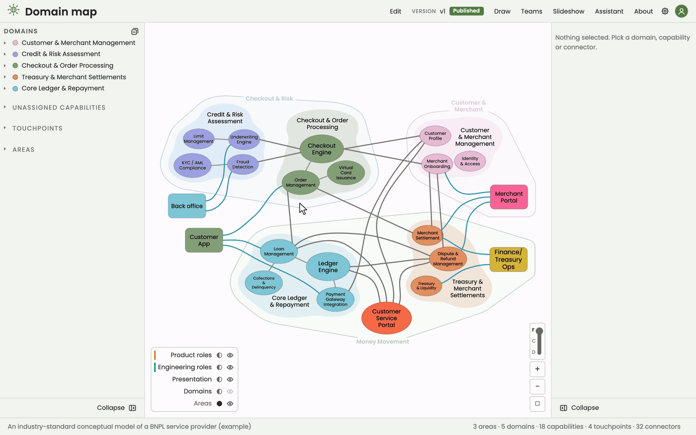

# Domain map

A shared **map** of your organization, so flow conversations start from context instead of a blank whiteboard.

The map is the fixed terrain: your domains and the business capabilities within them, each in a deliberate position. Whereas a diagram's layout is arbitrary -- rearrange it and nothing is lost -- a map anchors elements geometrically, so position carries meaning, and the terrain stays learnable across teams.

Flows are overlays. Trace a payment authorization from checkout through invoicing, financial booking, and settlement, and the route shows which teams are involved and how each participates in the end-to-end flow. Think of Google Maps as the terrain and your planned route as the overlay.

Establish the context once. Then draw on top of it -- with a marker or digitally -- every time after.



## Run it

```bash
# everything in Docker: the app, and the Postgres its versions live in
docker compose up

# or with Node, against that same Postgres
docker compose up -d postgres
npm install
npm start
```

Then open <http://localhost:8000>. The map that greets you is an example — an
industry-standard model of a BNPL service provider — for you to edit into your
own, or to replace wholesale with an [imported](#taking-it-elsewhere) one.

## Stop it

`Ctrl+C` stops the container in the foreground. From another terminal, or after `docker compose up -d`:

```bash
# remove the containers but keep the volumes: the icons, the settings and the versions
docker compose down

# remove the volumes too, and the map goes back to the example
docker compose down -v
```

## Drawing the map

The map opens read-only, so it can be handed around and pointed at without
anyone changing it by accident. **Edit** turns changes on, and while it is on
the two panels grow the buttons that make them.

**Domains and capabilities.** *Add a domain* puts a fresh one on open ground
beside the map. *Add a capability* follows the selection: into the selected
domain, beside the selected capability in the domain it already sits in, or on
open ground when nothing is picked. Name either in the **Title** field on the
right, or rename a domain in place by double-clicking its title on the map.
Each shape also carries a description and an owner, and a capability can carry
an icon.

**Features.** What a capability does, named one by one. *Add a feature* puts
one into the capability that is selected, after the ones it already holds. A
feature is drawn inside its capability's oval, in rows, once you are close
enough to read it. Drag one to move it about the oval, onto another to trade
places, or into another capability to hand it over; `[` and `]` move it along
the list.

**Arranging.** Drag a domain and everything inside it comes along. Drag the
boundary of a selected domain to give the lobe behind it more room, or less. Drag a
capability to move it within its domain, onto another domain to hand it over,
onto another capability to swap the two, or onto open ground to leave it loose.
A domain's title has its own place: drag it around the blob, and while
renaming it drag the bars at either side to set the width it wraps at.

**Areas.** The layer under the other two says who owns what. Pick
*Areas* in the layer control and *Add an area*: it arrives as a small
band with its title on it, and grows round whatever is put in it — drag a
domain, a touchpoint or a loose capability in from outside the line, or name
the area in the shape's **Area** field. A shape is in one area or in none.
Dragging a shape clear of its team only stretches the band after it; leaving is
said in the Area field, so that tidying the map never reorganises the company.
Drag the border to move a whole team's territory at once, and the title to
slide it round the border; Shift+Enter while renaming it breaks the title into
rows, which stack outside the band.

**Connectors.** Point at a domain, a capability or a feature and its connection
points appear. Drag from one to a point on another shape — or click one, then
the other — and a line joins them, in any combination of the three: a domain
to a domain where that is all there is to say, a feature to a feature where
the detail is known. Drag an end to move it, Shift-click a curved line to add a
bend, double-click a bend to take it out. A line that stays inside one domain
is drawn quietly, as internal plumbing; one that crosses a boundary is a public
event, and reads louder. A curved line you have not shaped goes round a domain
that lies in its way rather than across it.

**Colour.** *Edit palette* opens the map's own 24 colours in the bottom corner,
over an overlay that leaves the map in view. Every shape wears a swatch from
it, so recolouring the palette recolours the map.

**Light or dark.** The page follows your device, and **Theme** under the avatar
sets it for this browser whatever the device says. A dark map is drawn from the
same palette, each colour dimmed to sit on dark paper, so there is nothing to
recolour for it — and *Edit palette* goes on showing the colours as the light
theme draws them.

**Getting around** — the button in the header — lists every shortcut and
gesture there is: undo, bold, the size and shape steps, restacking, and the
keys that apply while renaming.

## Looking closer

The map says more the closer you look, and nothing on it moves as you do. Zoom
in on a capability and it **opens onto its features**; a row of pips along its
foot says it holds some. Double-click a domain or a capability to glide in to
it, and *Fit to screen* to glide back out. Browsing, a drag pans the map from
wherever it starts.

The slider over the zoom buttons sets the **level the lines are drawn at**,
without moving the map. At **F** every line is where it really ends, which is
how a map opens. At **C** a line that ends on a feature leaves from its
capability. At **D** every line leaves from a domain, and the lines between two
domains are one line, heavier the more it stands for — each domain keeping its
two strongest, so what is left is the main roads. Point at a line there to read
what it joins and how many it carries; pick a domain to see every line it has.

The level is the same in **Edit** mode, so the map does not change when you
leave it.

## Drawing on the map

**Draw**, in the header, is the marker the map was made to be drawn on with.
While it is on the map is locked — nothing on it is selected or moved — and a
drag draws: pick one of five markers from the tray on the stage, trace the flow,
rub a stroke out with the eraser, take a step back with Ctrl+Z. The wheel and a
pinch still zoom, and Space with a drag, the middle button or two fingers move
the map under the marker. What you draw rides the terrain as you pan and zoom,
and **Export SVG** carries it into the picture. It is a sketch for the
conversation in front of it, not part of the map: it is saved in no version,
nobody else sees it, a viewer can draw as freely as a contributor, and it lasts
through a refresh but not past the tab — or past opening another version in its
place. **Done**, Esc or Draw again puts the marker down and leaves the drawing
where it is.

## Asking an AI about the map

**Assistant**, in the header, takes the details panel's place. Pick a skill:
*Describe* the capability you have selected, *Fill the blanks* across a domain,
*Grill the boundaries*, *Find missing connections*, *Compare with a standard*,
*Trace a flow*, or *Ask your own*.

**With a model connected**, a contributor presses a skill and **Send**; *Ask your
own* opens a box for a question of your own. The answer comes back under the
button, and what it suggests as cards underneath. Only the last exchange is
shown and nothing of it is kept, though the model is reminded of the last few
turns until you **Start over** or reload. Connecting one is two environment
variables —

```bash
ASSISTANT_API_URL=http://localhost:11434/v1/chat/completions   # a local Ollama, say
ASSISTANT_API_KEY=ollama
ASSISTANT_MODEL=llama3.1
```

— and the URL can be anything that answers chat completions, free or corporate,
or Anthropic's Messages API. [docs/BRANDING.md](docs/BRANDING.md#what-it-needs-to-run)
has the rest. The key stays on the server, and the page says which host your
messages go to.

**Without one**, **Copy prompt** puts the task, the map and the format to answer
in on the clipboard; take it to the AI chat you use, and in **Edit** mode paste
the reply back and **Review reply**.

Either way the map goes out without its drawing — no positions, no colours — and
without owners' names unless you tick them in. It is the whole map, so send it
only where your organisation allows.

Every suggestion becomes a card that says what it would do and why; pressing a
name on it shows that shape on the map. **Apply**, in Edit mode, makes the change
as one Ctrl+Z. A reply can describe, rename, add, move and connect; it cannot
remove anything, so what it thinks should go arrives as a note for you to act on.

Say **what the business is** first — in the details panel, with nothing selected.
It is part of the map, it heads every prompt, and it is the difference between a
review of your business and a review of a map.

## Versions, and the one everyone sees

Versions are kept in Postgres, in two places. **My sandbox** is yours: what
you save there is nobody else's to see. **Shared** is what every contributor
sees: fixed copies put in the open, never saved over. One shared version is
**published** — the one anyone who signs in sees, and the one the map opens at.

**Save** writes the sandbox version that is open; on a shared one it puts a
copy in your sandbox instead, after asking. **Versions** — the chip naming the
one you are on — opens the two lists: open another, *Save as new* to keep the
current map as the next version in your sandbox, *Share* one into the open,
*Take a copy* of a shared one to work on, rename, delete, and — a publisher —
publish a shared one. **Cancel** unwinds everything done since **Edit** was
pressed, all at once.

Who may do any of this is a role, one to a person. Everyone who signs in is a
**contributor**: they open any version, edit, save, rename and delete. A
**publisher** also chooses which version is the map everyone sees. An
**administrator** also decides who is what, in **Users & access** under the
avatar: a role on each row, someone added by email ahead of their first
sign-in, and someone taken off the list — on every row but their own, so there
is always an administrator left. There can be several. A **viewer** sees the
published map and nothing else — nobody is one until an administrator says so.
The dialog opens on a sentence for each role saying what it may do.
`OWNER_EMAILS` seeds the list the first time the server starts, the first
address as the administrator; after that the list rules. With sign-in off, as
in `dev.env`, whoever is there is an administrator, which is what makes `npm
start` work with no configuration at all.

## Taking it elsewhere

**Export** downloads the whole map as JSON — the file to keep in a repo, diff,
or hand to someone else. **Import** replaces the map from one of those files.
**Export SVG** downloads the diagram as a picture, for a slide or a wall — in
the theme on screen, so switch to Light first for one to print.

## Make it your own

Another repo can install this as a package and supply its own branding, rather
than forking it. Scaffold one:

```bash
npx --package=github:alekseigurba/domain-map create-domain-map-app acme-domain-map --title "Acme domain map"
```

That writes a repo holding only what is yours — a ten-line server, a `brand/`
folder of token overrides and a `seed/` folder with your starting map — and
installs the app from a git tag. [docs/BRANDING.md](docs/BRANDING.md) is the
contract: which files a consumer may override, which are internal, and how the
palette follows the stylesheet.

The `Dockerfile` and `docker-compose.yml` in this repo run the example app. A
consumer repo gets its own, which installs the package instead of copying
`app/`.

## Working on domain-map itself

[docs/DEVELOPMENT.md](docs/DEVELOPMENT.md) covers the repo: how it is laid out,
how to run the tests, and how a release is cut.
